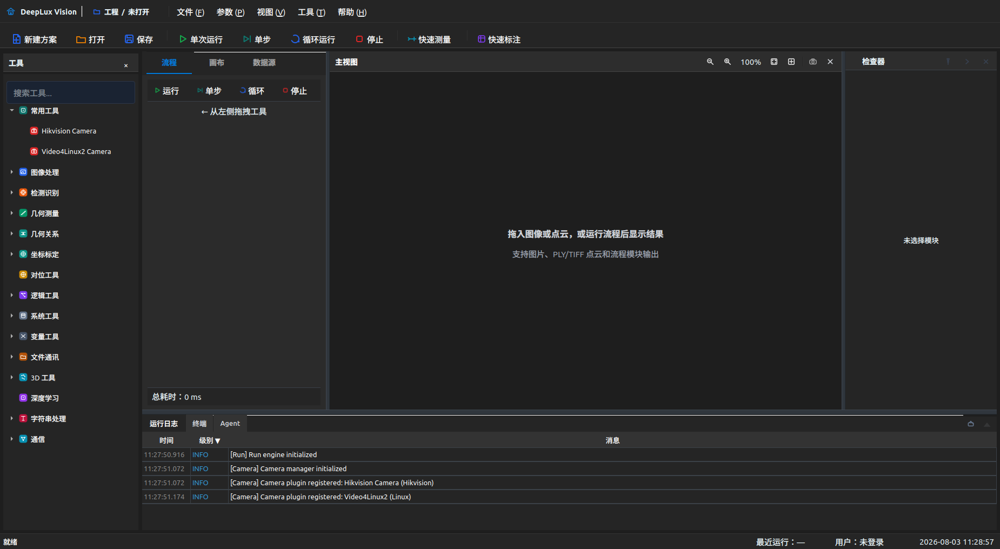

# DeepLux Vision

DeepLux Vision 是面向工业现场的跨平台机器视觉软件：以可视化流程组织采集、预处理、检测、测量和控制，算法以动态插件交付；支持单步调试、结果叠加、受控 Agent 与 SAM 快速标注。



## 当前状态

- 默认构建 **66** 个运行时插件（启用 `-DENABLE_HYMSON3D=ON` 后为 67 个）。
- CI 覆盖 Linux Qt 5/6 完整 CTest、Windows MSVC 产品构建与插件同步/部署冒烟；Windows 本机已验证完整 CTest **77/77**。
- 原生 SAM 已完成 Windows 编译/打包验证；真实模型推理、相机/PLC 硬件仍需现场验收。

## 核心能力

- **可视化流程**：从工具栏添加模块、连接数据流，在画布中查看节点状态与单节点耗时。
- **可控执行**：单次、单步、循环和停止；单步只执行当前节点，便于检查中间结果。
- **结果检视**：主视图显示图像、点云和检测叠加，检查器展示参数、模块信息与运行结果。
- **快速测量**：无需流程即可拾取两点距离、点到线距离、线段间距、三点角度/拟合圆、矩形面积。
- **插件扩展**：图像处理、检测识别、几何测量、标定、逻辑、通信、变量、3D 和相机插件按需加载。
- **Agent 与 SAM**：Agent 通过受控工具调用操作流程（可确认、可撤销、可审计）；SAM 支持正/负点、框选生成掩膜并导出 LabelMe/YOLO/COCO。

架构上，UI 通过工程模型驱动 `RunEngine`，插件由 `PluginManager` 动态加载；Agent 与 SAM 作为独立受控模块接入。详见[架构说明](docs/architecture.md)。

## 快速开始

### 环境要求

| 依赖 | 要求 |
| --- | --- |
| 构建工具 | CMake 3.16+、C++17 编译器 |
| Qt | 6.6+（或 5.15.3+）：`Core Gui Widgets Network Sql Test Concurrent SerialPort` |
| OpenCV | **必需**；缺失时配置阶段直接失败 |
| Eigen | 3.4，用于 3D 数学 |
| ONNX Runtime | 可选；原生 SAM 默认开启，未提供 `ONNXRUNTIME_DIR` 时加 `-DDEEPLUX_NATIVE_SAM=OFF` |

Windows 额外需要：Visual Studio 2022/2026 的“使用 C++ 的桌面开发”、Qt MSVC 套件（含 `qtserialport`）、OpenCV Windows 预编译包（或 vcpkg）、可用的 `Eigen3Config.cmake`。完整依赖与路径配置见 [Windows 构建与部署](docs/windows-build.md)。

### 编译

Linux：

```bash
cmake -S . -B build -DDEEPLUX_QT_PATH=/path/to/Qt/6.6.0/gcc_64 -DBUILD_TESTS=ON
cmake --build build -j$(nproc)
```

Windows（在 Developer PowerShell for VS 中执行）：

```powershell
cmake -S . -B build-win -G Ninja -DCMAKE_BUILD_TYPE=Release `
  -DDEEPLUX_QT_PATH=C:/Qt/6.8.3/msvc2022_64 `
  -DOpenCV_DIR=C:/opencv/build -DEigen3_DIR=C:/deps/eigen3 `
  -DBUILD_TESTS=OFF -DDEEPLUX_NATIVE_SAM=OFF
cmake --build build-win --parallel
```

> vcpkg、Visual Studio 生成器、Qt/OpenCV/Eigen 路径与多配置说明见 [Windows 构建与部署](docs/windows-build.md)。
>
> 常用选项：`-DUSE_QT6=ON|OFF`、`-DENABLE_HYMSON3D=ON`、`-DENABLE_CAMERA_BASLER=ON`、`-DENABLE_CAMERA_HIKVISION=ON`。

### 运行与部署

Linux：

```bash
cmake --build build --target sync-plugins
./build/bin/DeepLux --gui
```

Windows：

```powershell
cmake --build build-win --target sync-plugins
powershell -ExecutionPolicy Bypass -File scripts\deploy-windows.ps1 `
  -BuildDir build-win -Prefix dist\DeepLux-win64 -Zip
.\dist\DeepLux-win64\bin\DeepLux.exe --gui
```

- `sync-plugins` 把插件与 `metadata.json` 同步到 `~/.deeplux/plugins`；开发期也可直接从 `build-win\bin` 运行，但需把 Qt/OpenCV 的 `bin` 加入 `PATH`。
- 部署脚本生成自包含目录（Qt、OpenCV、VC++ 运行库、66 个插件），并在干净 `PATH` 下做 CLI 冒烟测试；成功标志为 `plugins: 66`、`[SMOKE] exit=0 loaded=65`，输出包为 `dist\DeepLux-win64.zip`。目标机未安装 VC++ 运行库时，先运行一次 `bin\vc_redist.x64.exe`。
- Windows CLI 使用部署包内的 `deeplux.cmd`（GUI 子系统 exe 在 PowerShell 中不会等待进程）：

```powershell
.\dist\DeepLux-win64\bin\deeplux.cmd --cli info
.\dist\DeepLux-win64\bin\deeplux.cmd --cli list-plugins
```

常见问题（OpenCV `vc16` 兼容性、缺少运行库、插件未加载等）见 [Windows 构建与部署](docs/windows-build.md)。

## 典型流程：从图像到找圆结果


1. 新建工程，添加 `GrabImage`、`FindCircle` 和结果输出模块并在画布中连线。
2. `GrabImage` 选择文件/文件夹或相机作为图像源。
3. `FindCircle` 设置半径范围、Canny 阈值和累加器阈值。
4. 使用“单步”逐节点查看输出，或“运行”执行整个流程。

更完整的操作与排查见[快速上手](docs/quick-start.md)。

## Agent 与 SAM

- **Agent**：底部“Agent 对话”页。只能调用已声明的内部工具，写操作经过权限、确认与撤销，全部落审计日志；不具备任意 shell 执行权限。详见[终端与 Agent 设计](docs/Terminal_Agent_Design.md)。
- **SAM 标注**：顶部“快速标注”打开面板，用正点、负点或框选生成预览，切换候选后确认；支持掩膜编辑、会话保存及 LabelMe/YOLO/COCO 导出。默认使用 Python 服务；切换到“本机 ONNX”后可在“模型设置…”中选择模型包和 CPU/CUDA 设备，设置会保存到本机。详见[原生 SAM 安装说明](docs/sam_native/stage5_packaging.md)。

## 项目结构

```text
src/app/          # 应用入口（GUI / CLI）
src/core/         # 工程模型、RunEngine、插件/设备/Agent/SAM 服务
src/ui/           # 主界面、流程画布、视图、检查器、对话框
src/plugins/      # 按领域组织的动态插件
tools/sam_server/ # SAM FastAPI 运行时
tests/            # Qt Test 单元与界面测试
docs/             # 使用、设计和验收文档
cmake/            # CMake 查找与构建辅助模块
scripts/          # 构建、插件同步、部署和 CLI 辅助脚本
```

## 文档

| 文档 | 内容 |
| --- | --- |
| [快速上手](docs/quick-start.md) | 创建找圆流程、单步检查、常见排查。 |
| [Windows 构建与部署](docs/windows-build.md) | MSVC 依赖、Ninja/VS 配置、插件同步、CTest、windeployqt 打包与常见问题。 |
| [架构说明](docs/architecture.md) | UI、工程、执行引擎、插件、Agent 与 SAM 的职责边界。 |
| [插件手册](docs/plugins.md) | 运行时插件的用途、接入方式、配置与失败条件。 |
| [CLI 文档](docs/cli.md) | GUI 之外的项目、模块与连接管理命令。 |
| [终端与 Agent 设计](docs/Terminal_Agent_Design.md) | 受控工具调用、审计与权限模型。 |
| [工程技能图谱](docs/skills/README.md) | UI、插件、测量、流程、Agent、SAM 与质量验证的方法集。 |
| [3D 设计文档](docs/design/) | 点云渲染、LOD 和相关设计记录。 |

## 开发与验证

Linux：

```bash
cmake --build build --target sync-plugins
ctest --test-dir build --output-on-failure
```

Windows（完整说明见 [Windows 构建与部署](docs/windows-build.md)）：

```powershell
cmake -S . -B build-win-tests -G Ninja -DCMAKE_BUILD_TYPE=Release `
  -DDEEPLUX_QT_PATH=C:/Qt/6.8.3/msvc2022_64 -DOpenCV_DIR=C:/opencv/build `
  -DEigen3_DIR=C:/deps/eigen3 -DBUILD_TESTS=ON -DDEEPLUX_NATIVE_SAM=OFF
cmake --build build-win-tests --parallel
ctest --test-dir build-win-tests --output-on-failure --timeout 300
```

新增或修改插件后需完整重建并执行 `sync-plugins`，避免主程序与插件 ABI 不一致。参数 Schema、`validateParams()`、`clone()` 等契约由 `test_pluginparametercontracts` 持续校验；约定见 [AGENTS.md](AGENTS.md)。

## 许可证

当前仓库未附带许可证文件。使用、分发或二次开发前，请与项目维护方确认授权范围。
