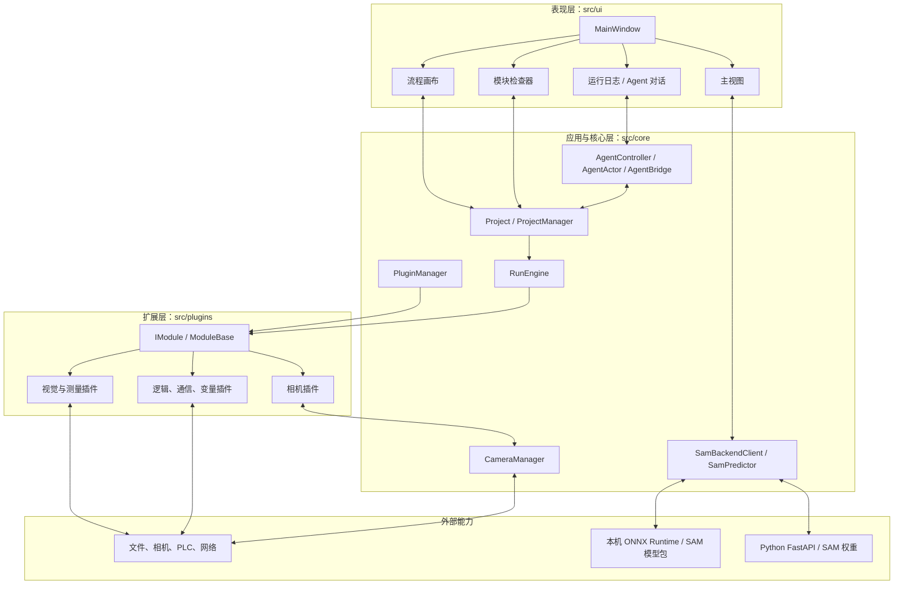
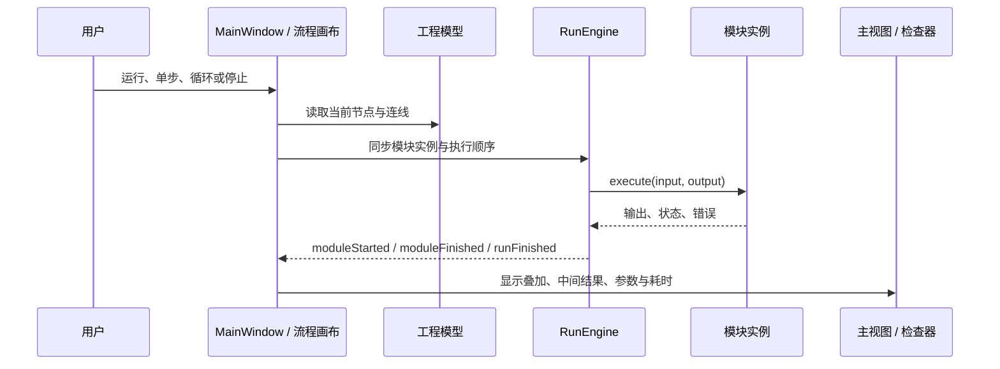
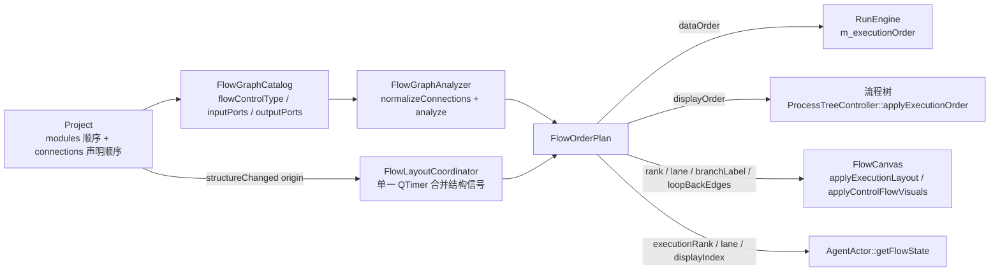
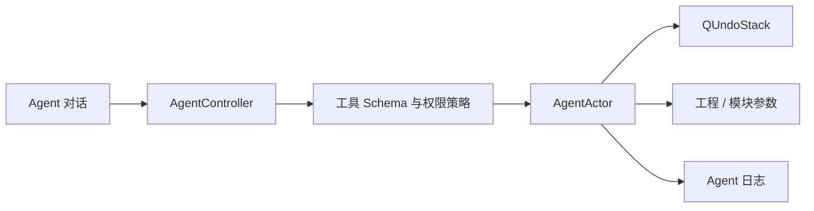
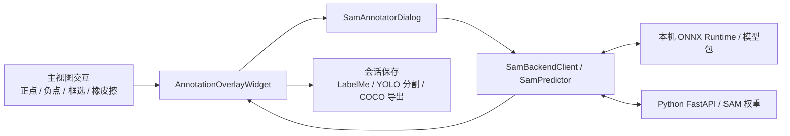

# DeepLux 架构说明

本文说明 DeepLux 的运行时边界。目标是让视觉流程、插件、设备接入和 AI 能力可以分别演进，同时保持工程可保存、运行可追踪、写操作可审计。

## 分层与职责



| 层 | 主要职责 | 不承担的职责 |
| --- | --- | --- |
| UI | 组织工作区、编辑工程、显示中间结果、发起执行和展示状态。 | 不直接实现算法或管理插件生命周期。 |
| 工程模型 | 保存模块实例、连线、布局和参数。 | 不执行视觉算法。 |
| RunEngine | 根据工程顺序运行模块，管理运行状态、单步、循环、停止、输出和耗时。 | 不渲染 UI，也不解析插件配置页面。 |
| PluginManager | 发现动态库、校验接口版本、读取元数据并创建独立模块实例。 | 不保存工程或决定业务流程。 |
| 插件 | 处理一个明确的视觉、测量、控制或通信职责，声明参数和结果。 | 不直接修改主窗口或其他插件的私有状态。 |

## 流程执行与结果回传



- **运行**执行当前工程一次。
- **单步**仅推进一个模块，并保留当前输出供主视图和检查器查看。
- **循环**按周期重复运行；不需要调试会话，因此不会为每个循环额外创建检查断点。
- **停止**向执行引擎发出停止和取消请求，流程修改前会先脱离引擎持有的模块指针。

### 执行线程、亲和性与后台服务

- **FlowExecutionService**（`core/engine/FlowExecutionService.*`）是 UI、Agent 与 CLI 共用的后台执行入口：
  - 常驻一条专用工作线程（`WorkerThread` 阻塞在 `QWaitCondition`，不依赖 Qt 事件循环），不按 job 创建线程；`shutdown()` 仅在 Idle 时销毁线程，下次启动按需重建。
  - 命令槽深度为 1：非 Idle 状态拒绝新的 `startSingle/startCycle/stepOnce`（不排队），`Paused` 只接受 `continueRun()`/`stop()`；状态为 `Idle/Running/Paused/Stopping`，job 类型为 `Single/Cycle/Step/Resume`。
  - `startX()` 采用启动握手：工作者取得 job 租约并提交 `Running` 后才返回 `true`，因此调用方拿到“已启动”时 `RunEngine::isBusy()` 已为真。
  - job 租约 `RunEngine::JobToken`（id + 进程内随机盐）覆盖整个 job（含 Cycle 轮间）；租约未结束时工程修改与其它启动入口被拒绝。所有服务信号（`jobStateChanged/jobFinished/jobFailed`）都从工作线程发出，UI/Agent 以 queued 连接消费。
- **执行亲和性 `execution.affinity`**（`metadata.json`，默认 `gui`）：
  - `gui`：模块在 GUI 线程执行；后台工作者通过 `BlockingQueuedConnection` 回投 GUI 线程。
  - `worker`：模块直接在服务工作线程内联执行；满足 `threadSafe && !blocking` 时也可进入并行批次。
  - 串行与并行入口共用同一亲和性判定；`worker` 亲和模块不得触碰 QWidget/QPixmap/QPainter/OpenGL/相机/事件循环或创建跨线程 QObject。只有通过 B9 审计（静态 + GUI/worker 双实例一致性）的插件才标记 `worker`，当前名单与限制见 [插件手册](plugins.md#执行亲和性executionaffinity与审计状态)。
- **暂停、停止与收尾**：用户暂停在模块边界生效（`pauseForJob`），保留已完成的流水线、控制队列与运行模式且**不**发 `runFinished`；`continueRun()` 提交一个 `Resume` 段恢复执行。`stop()` 设置 job 级取消标志并立即返回，状态 `Stopping→Idle`，`jobFinished(stopped=true)`。断点暂停与用户暂停在 Agent 侧分别以 `pauseReason=breakpoint/user` 区分。
- **结果回传与刷新链路**：`RunEngine::displayFrameReady`（工作线程发出）→ MainWindow 按 `(jobId, runId)` 取 `latestDisplayFrame(viewportId)` 并做身份校验（`DisplayFrame::matchesIdentity`，旧 job/旧轮迟到帧直接丢弃）→ `ImageRefreshCoalescer`（约 50ms 频率上限 + latest-wins）→ `DisplayManager::displayImage(..., preserveView=true)` → 视口；`dataDisplayed(viewportId)` 在渲染后发出，仅用于视口绑定（测量叠加归属）。`moduleFinished` 只更新节点状态、耗时与检查器（点云 3D 专用路径例外），不再直接刷新大图。测量叠加只读同帧快照，不读引擎实时输出。Agent 的 `run_flow/pause_flow/resume_flow/stop_flow` 同样经服务执行，`run_flow(wait=true)` 在 job 真正回到 Idle 后才返回。
- **Stopping 语义备注**：设计文档 §5.1 的状态转换列表包含 `Stopping`；实现只在停止请求实际胜出时短暂提交 `Stopping` 后立即 `Idle`（正常/失败收尾不经过 `Stopping`）。该措辞差异的取舍与理由见 [后台执行验收报告](reports/background-execution-acceptance.md)。

## 执行顺序布局（FlowGraphAnalyzer / FlowOrderPlan / FlowLayoutCoordinator）

针对「同一工程在引擎、流程树、画布上出现三套顺序」的问题，B1–B5 引入单一计划源：所有展示与运行顺序都由 `Project` 的模块声明顺序、连接声明顺序和插件端口契约推导，不再由流程树行序或显示名反推。



### 职责

| 组件 | 职责 | 不承担 |
| --- | --- | --- |
| `FlowGraphAnalyzer` | 纯逻辑：`normalizeConnections`（统一边类型归一化，隐式 `next`/`control` 与 `PortSpec.control` 判定只在此实现一次）与 `analyze`（生成计划）；`validateCandidate` 只读校验拖动候选 | 不访问 `PluginManager`/`ModuleBase` 单例，不修改 `Project` |
| `FlowGraphCatalog` | 一次分析/校验范围内全部模块描述符，字段为 `instanceId`、`flowType`、`inputPorts`、`outputPorts`。引擎从已加载 `ModuleBase*` 构建、UI 从 `m_flowModules` 构建、Agent 按 `ModuleInstance.moduleId` 用 `PluginManager::createModule()` 构建 | 调用方不得各自推断边类型或从树顺序/显示名推断模块 |
| `FlowOrderPlan` | `dataOrder`（旧 FIFO 运行顺序）、`displayOrder`（前向依赖拓扑展示序）、`nodes`（`rank`/`lane`/`displayIndex`/`branchLabel`/`controlParent`）、`controlEdges`、`loopBackEdges`、`reentrantModules`、`loopRegions` | 不等于动态执行轨迹；控制分支只保证前向依赖与分组 |
| `FlowLayoutCoordinator` | 连接 `Project` 结构信号，用**单一 single-shot `QTimer`** 合并同一事件循环内的多次变更；`Full`/`Normalize` 布局画布、把 `displayOrder` 写入流程树；`suppressAutoLayout` 用于命令应用期间抑制自动重排 | 不决定引擎顺序；不覆盖用户手工拖动的位置 |
| `Project::layoutInitialized` | 工程 JSON 中的布局标志。`true` 且坐标有效时工程切换**原样保留画布坐标**，仅按计划排流程树；`false` 或坐标非法时才执行 `Full` 并置 `true` | 不在已初始化工程上强制重排 |
| `Project::structureFingerprint` / `structureFingerprintFor` | 模块顺序 + 连接声明顺序（含声明下标与四元组 + `edgeType`）的 SHA-1，**不排序连接**；为 `ReorderLinearChainCommand` 的 before/after 快照与跨栈失效提供一致性判据 | 不替代图/端口校验（由 `validateCandidate` 完成） |

### 三套顺序如何分离

1. **规范输入**：`Project::modules()` 是分析器的 `moduleOrder`，`Project::connections()` 保持声明顺序；二者共同决定 `dataOrder`。
2. **引擎 `dataOrder`**：`RunEngine::buildExecutionOrder()` 从已加载 `ModuleBase*` 构建 catalog，调用 `analyze` 后取 `plan.dataOrder`。`MainWindow::syncModulesToRunEngine()` 按 `Project::modules()` 顺序 `engine.addModule()`，流程树只提供 `instanceId -> QTreeWidgetItem*` 映射（B3.1b 的 P0-3 修复）；因此重排流程树不会改变运行顺序。
3. **展示 `displayOrder`**：`FlowLayoutCoordinator` 成功后调用 `ProcessTreeController::applyExecutionOrder(plan.displayOrder)`；纯数据图 `displayOrder == dataOrder`，控制流图是前向依赖图的合法拓扑序。
4. **画布 rank/lane**：`FlowCanvas::applyExecutionLayout(plan, Full/Normalize)` 用 `rank` 决定 Y、`lane` 决定 X；`applyControlFlowVisuals(plan)` 把 `branchLabel` 画成节点徽标、把 `loopBackEdges` 画成虚线 + 箭头 + `LOOP` 标记。徽标只扩大 `boundingRect()`，`shape()` 固定为原始矩形，**不影响鼠标命中与选择**。
5. **Agent 只读字段**：`get_flow_state` 按 `Project` 顺序构建 catalog 并追加 `executionRank`/`lane`/`displayIndex`（字段只增不改）；布局仍由 `Project` 结构信号驱动协调器，Agent 不直接改画布/流程树。

### 结构编辑与跨栈撤销

- `Project::applyStructureTransaction(candidate, origin, error)` 一次性替换模块顺序与连接，成功后 `touch()` 并发 `structureChanged(origin)`；任一前置校验失败直接返回、零修改。
- `StructureEditOrigin` 取值为 `Gui` / `Agent` / `System`。Gui 与 Agent 撤销栈互相监听对方来源的结构变更，按 session token + 指纹把已失效命令 `setObsolete(true)`，避免交错撤销覆盖后续编辑。
- 流程树拖动先经 `FlowGraphAnalyzer::validateCandidate` 只读校验（无连接顺序列表任意重排；已连接简单线性链按统一端口模式重连；分支/汇合拒绝），再由 `ReorderLinearChainCommand` 在**首次 `redo()`** 内提交唯一一次事务；命令应用期间抑制自动布局，由命令内显式刷新树、连线、位置与引擎同步。
- `FlowCanvas::connectionKey` 与 `FlowGraphAnalyzer` / `RunEngine` 生成 `loopBackEdges` 的规范键一致（`from + 0x1F + to + 0x1F + fromPort + 0x1F + toPort`），画布去重与回边判定共用同一条规则。

验收命令、逐项结论与风险登记见 [执行顺序布局验收报告](reports/execution-order-layout-acceptance.md)。

## 插件契约

每个可实例化插件实现 `IModule`，并由 `metadata.json` 提供界面描述。该契约包含：

- 基本身份：模块 ID、名称、分类、版本、图标和描述。
- 生命周期：初始化、关闭和状态。
- 算法入口：`execute(const ImageData& input, ImageData& output)`。
- 参数：默认值、当前值、单项设置、批量校验和序列化。
- 配置：可选的高级配置页面，以及由元数据生成的通用检查器控件。
- 兼容性：接口版本不匹配的插件会被拒绝加载，避免主程序与插件虚表不一致。

模块实例不能共享模板状态。工程中的每个节点均由插件模板克隆而来，参数、显示名称和运行数据相互独立。

## 数据契约与端口（ABI v2）

跨模块数据一律以 `DataType` 声明（`core/deeplux/DataContract.h`），`metadata.json` 的 `ports` 声明输入/输出端口的类型、必需性与多输入语义。运行期由 `ModuleBase::execute(PortValueMap...)` 桥接层负责：

- 输入侧：按端口声明做必需性与类型校验，不匹配时返回结构化错误码（`ExecError::MissingRequiredInput` / `TypeMismatch`），不进入 `process()`。
- 输出侧：只导出 `metadata.json` 声明过的命名端口，未声明的输出不进入下游。

**兼容传输策略**：`ImageData` 作为图像载体的同时，可承载命名数据键（`setData`/`data`）；
旧式 `process(ImageData, ImageData)` 插件产出的命名数据，由桥接层按端口声明显式化为端口值。
这是 ABI v2 阶段明确的兼容传输方式，不代表"任意键都能跨模块流动"——未在 `metadata.json`
声明的键不会导出为端口。

**未实现类型在加载期拒绝**：`Mask2D`、`Ellipse2D`、`Transform2D`、`ClassScores`
尚无载荷契约与生产者插件（`Region2D` 已于 SAM 批1 落地：载荷契约 + `SamPredict`
生产者 + `RegionStats` 消费者，并由 `isSupportedPortType` 放行）。枚举值保留以维持
ABI 稳定，但 `metadata.json` 声明未落地类型会在 `PluginManager::loadPluginMetadata`
阶段被明确拒绝（错误信息指明端口与类型），避免"连接合法、运行期永远拒绝"的
悬空端口；待对应载荷与插件落地后再放开。

## Agent 边界

Agent 的 UI 入口是底部“Agent 对话”页，审计入口是“Agent 日志”页。其调用路径为：



- Agent 只能调用注册的内部工具，例如读取流程、添加模块和设置参数。
- 写操作按照权限等级执行确认；可撤销操作通过 `QUndoStack` 管理。
- `AgentBridge` 提供结构化 IPC 协议中的 `tool_call`、`query`、`subscribe` 和 `ping`。
- 任意 shell `execute` 请求被明确拒绝。真实终端仅供人类用户和 CLI 使用，不能成为 Agent 的通用执行通道。

详细协议与权限策略见 [终端与 Agent 设计](Terminal_Agent_Design.md)。

## SAM 快速标注边界

SAM 标注是主视图上的交互能力，而不是普通流程插件：标注需要用户反复添加正点、负点或框选，并即时查看掩膜预览。



- `HImageWidget` 负责图像显示、缩放和坐标变换；标注叠加层独立维护掩膜、多边形和提示点，避免与测量叠加混杂。
- `SamBackendClient` 管理 Python 服务进程和 HTTP 请求；原生路径由 C++ ONNX 推理核心执行。两条路径都可复用同图 embedding，换图后重新编码。
- 原生 SAM 默认参与编译，需在配置时提供 ONNX Runtime SDK；运行时通过标注面板选择并持久化模型包，不需要 Python。`DEEPLUX_SAM_PACKAGE` / `DEEPLUX_SAM_DEVICE` 作为部署覆盖项保留。Python 服务仍是标注面板默认后端，其依赖和权重与 C++ 构建隔离。模型文件均不应提交到仓库；CPU/CUDA 与异机部署的验证边界见[安装说明](sam_native/stage5_packaging.md)。
- 掩膜编辑算法集中在 `MaskOps`（`core/model/AnnotationMaskOps`，纯函数无 UI 依赖）：形态学膨胀/腐蚀（可分离滑窗，越界按背景）、8-连通分量、Moore 外轮廓追踪、橡皮擦笔画、多边形栅格化，以及与 sam_server `_encode_rle` 语义一致的 RLE 编解码（列主序，损坏输入失败关闭）。
- 标注对话框对已确认对象提供膨胀/腐蚀/橡皮擦/合并/拆分（SAM 批2）：编辑作用于整图尺寸二值掩膜（来源优先级：内存缓存 → maskRle → polygon 栅格化重建），完成后重导出 polygon/bbox/maskRle；每次编辑整体入撤销栈，可精确回滚。空结果、多连通分量结果（单多边形模型无法如实表达）、不连通区域的合并均失败关闭并给出状态栏提示，不静默丢像素；拆分保留最大分量的原对象身份，派生对象 score=0（非 SAM 预测，不伪造置信度）。
- Agent 工具化（SAM 批3）：`sam_predict`（单次 prompt 分割，返回 label/score/bbox/polygon JSON，不回传 RLE 本体防上下文爆炸）与 `sam_annotate`（1–16 项批量分割并追加写入 `.deeplux-anno.json` 会话，全有或全无、混图拒绝）注册进 ToolSchema 白名单，与 `SamPredict` 插件共享 `SamPredictor` 同步预测核心（栈上客户端 + 本地事件循环 + 取消轮询 + Region2D 契约门禁；批量项间经事件循环延迟发起，避免在客户端回复 settle 前重入）。权限口径：两者均非 readOnly（最小权限，Observer 拒绝）；`sam_annotate` 为 dangerous（写文件，Autopilot 也需确认）。
- 导出/导入扩展（SAM 批4）：`CocoExporter`（`core/io`）把会话导出为 COCO instances JSON——area 取值链 maskRle 前景像素数 → polygon 鞋带面积 → bbox 面积，segmentation 为展平多边形环；类别 id 1 起、参数顺序优先并按出现追加；空标注/无效宽高/空标签失败关闭；`QSaveFile` 原子写。`LabelMeImporter` 严格解析 LabelMe shapes（label 非空、points ≥2 且为有限 [x,y] 对、shape_type 缺失按点数推导），`rectangleBoxes` 仅提取非退化矩形并归一化，跳过形状计数显式报告；`sam_annotate` 增加 `labelMePath` 参数与 `items` 互斥二选一（XOR），矩形转 box prompt 批量分割。
- 多掩膜候选（SAM 批4）：sam_server `/predict` 增返 `candidates`（≤3，score 降序，`candidates[0]` 与顶层 best 字段一致，旧客户端不受影响）；`SamBackendClient` 严格解析（可选字段、上限 8、元素级失败关闭）并经 `lastCandidates()` 暴露；`SamPromptItem.candidateIndex`（0=最佳）在 `SamPredictor` 收口选择——越界、负值、后端无候选却指定 index>0 均失败关闭，`SamPredictOutcome.candidateScores` 回传各项 score 列表；对话框以 ◀/▶ 循环切换预览（candidates>1 才显示循环行），确认写入的是所选候选；`sam_predict`/`sam_annotate` 透传 `candidateIndex`（[0,7] 整数守卫）并回传 candidateCount/candidateScores 摘要供 LLM 改选。

## 验证边界

核心改动的最低验证集应覆盖：

```bash
cmake --build build -j$(nproc)
ctest --test-dir build --output-on-failure
cmake --build build --target sync-plugins
```

界面变更还应在 GUI 中检查流程、主视图、检查器和底部日志的联动；插件接口或元数据变更还应验证插件重建和运行时加载。
